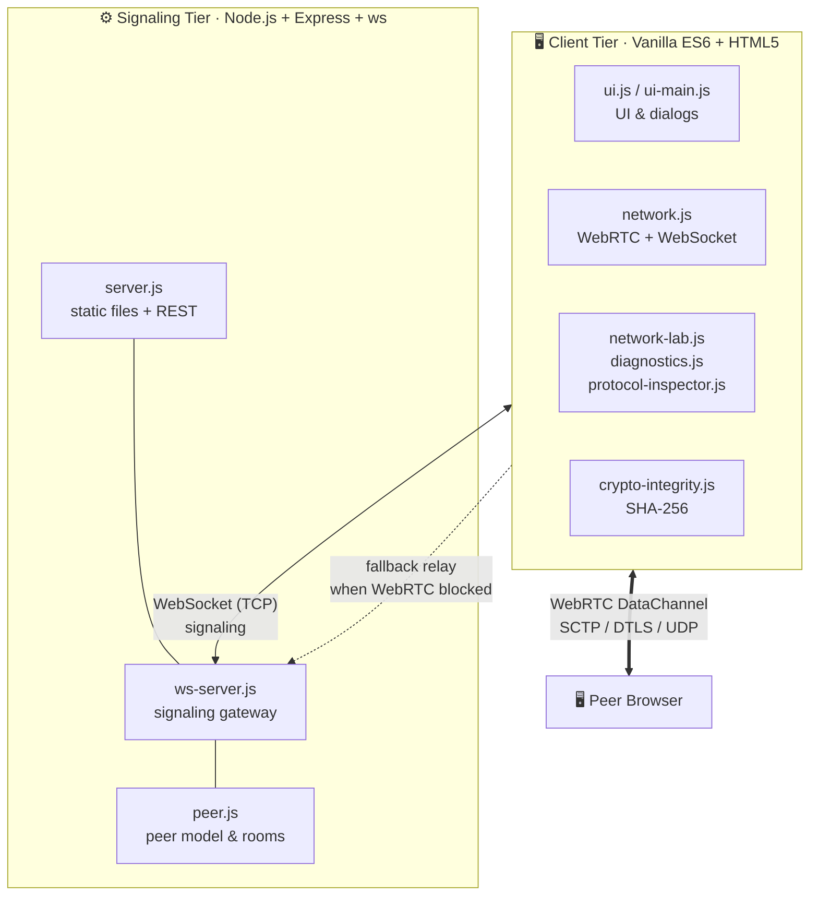
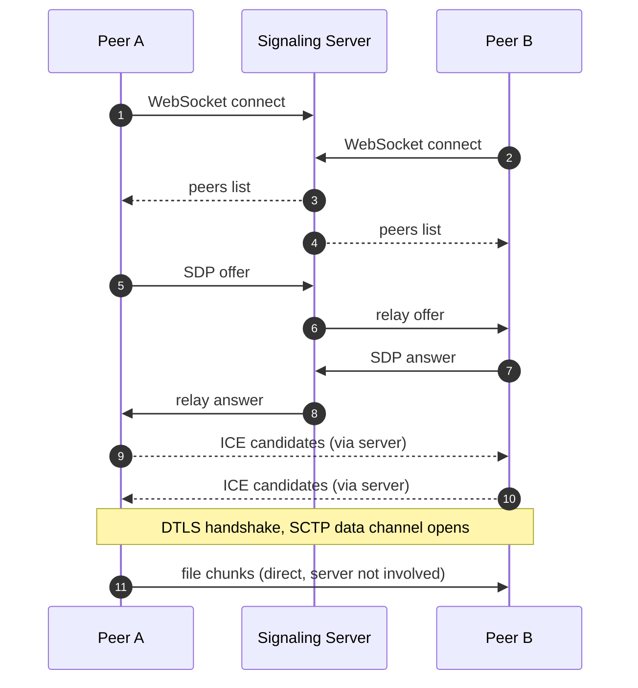
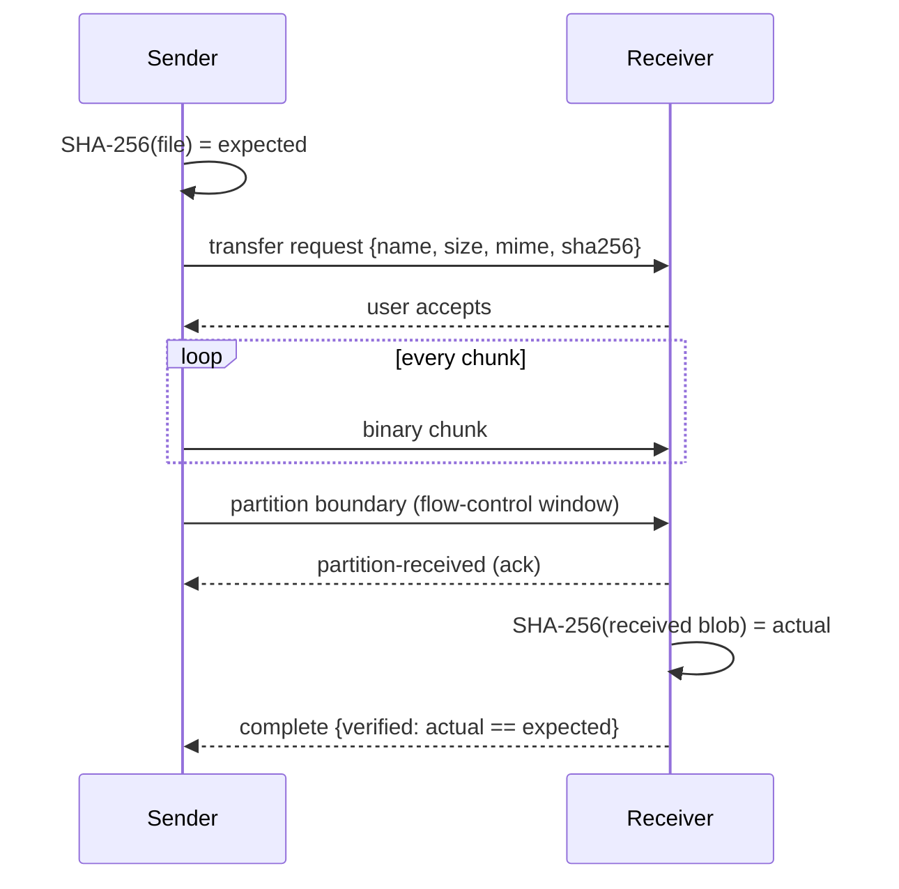

<div align="center">


# NetBridge

### Peer-to-peer file sharing + a built-in network diagnostics lab

Send files between any two devices straight from the browser, with no cloud, no accounts, and no internet needed on a LAN. Then open the Network Lab and watch the protocols work.

[](https://nodejs.org/)
[](https://www.w3.org/TR/webrtc/)
[](https://github.com/websockets/ws)
[](https://expressjs.com/)

[](https://www.w3.org/TR/WebCryptoAPI/)
[](https://datatracker.ietf.org/doc/html/rfc8831)
[](#-install-as-an-app)
[](#-install-as-an-app)
[](package.json)
[](#-license--credits)
[](#-contributing)

[](https://github.com/furqanzubair209-cell/NetBridge/stargazers)
[](https://github.com/furqanzubair209-cell/NetBridge/network/members)

[**Quick Start**](#-quick-start) · [**Features**](#-features) · [**Architecture**](#-architecture) · [**Network Lab**](#-the-network-lab) · [**API**](#-rest-api) · [**Viva Guide**](#-viva--defense-guide)

</div>

---

## ✨ Why NetBridge?

Most file-transfer tools hide the networking. NetBridge does the opposite. It is a working transfer app **and** a teaching tool: every handshake, ICE candidate, chunk, and hash is visible, measurable, and exportable.

| | |
|---|---|
| ⚡ **Direct P2P** | Files travel browser to browser over WebRTC data channels. The server never sees your data. |
| 📶 **Works offline on LAN** | Same Wi-Fi or switch? No internet is used at all. Devices find each other automatically. |
| 🔐 **Encrypted + verified** | DTLS encryption in transit, plus SHA-256 end-to-end integrity checking on every file. |
| 🔬 **Built-in Network Lab** | Latency, jitter, NAT analysis, chunk-size benchmarks, and bit-flip demos with CSV export. |
| 🛟 **Automatic fallback** | If WebRTC is blocked, traffic is relayed through the WebSocket server. |
| 📱 **Every device** | Desktop, phone, and tablet browsers, installable as a PWA, with a ready-to-sideload Android APK. |

---

## 🚀 Features

**File sharing**
- Drag and drop or tap to send files, folders of files, and text messages
- Accept/decline prompts with optional **auto-accept** for paired devices
- Permanent **device pairing** with a key or QR code
- Temporary **public rooms** to connect across different networks
- HEIC image conversion, ZIP bundling for multi-file receives, and screen wake-lock during transfers
- Light, dark, and auto themes with localization support

**Network Console** (globe icon in the header), seven tabs:

| Tab | What it shows |
|---|---|
| 🗺️ **Topology** | Live view of discovered peers and connection paths |
| 📊 **Telemetry** | Real-time transfer stats and RTC metrics |
| 🩺 **Diagnostics** | Latency, jitter, ICE gathering, NAT type, bandwidth estimate, quality grade |
| 🔬 **Lab** | Repeatable experiments with CSV export |
| 🔒 **Integrity** | SHA-256 verification and the bit-flip demo |
| 🧾 **Inspector** | Protocol frame log |
| 🖥️ **Server** | Server NICs, uptime, and signaling counters |

---

## ⚡ Quick Start

**Requirements:** [Node.js](https://nodejs.org/) 18 or newer and any WebRTC-capable browser (Chrome, Edge, Firefox, Brave, Safari).

```bash
# 1. Clone
git clone https://github.com/furqanzubair209-cell/NetBridge.git
cd NetBridge

# 2. Install
npm install

# 3. Run
npm start
```

Open **http://localhost:3000**. To connect a phone or another laptop on the same Wi-Fi, open `http://<your-LAN-IP>:3000` on it (find the IP with `ipconfig` on Windows or `ip a` on Linux/macOS).

> 🪟 **Windows shortcut:** double-click **`start-netbridge.bat`**. It checks for Node, installs dependencies on first run, adds a firewall rule for port 3000, prints your LAN address, and opens the browser.

### Configuration

| Option | How | Effect |
|---|---|---|
| Port | `PORT=8080 npm start` | Change the listening port (default `3000`) |
| Rate limiting | `--rate-limit` or `RATE_LIMIT=true` | Enable request rate limiting |
| Auto-restart | `--auto-restart` | Restart the server if it crashes |
| Localhost only | `--localhost-only` | Bind to loopback only |
| Production preset | `npm run start:prod` | Rate limiting + auto-restart |

---

## 📱 Install as an App

- **PWA:** click the install icon in your browser's address bar, or use the **Install NetBridge** button in the header.
- **Android:** download the APK from the **Download APK** button in the app, or grab it from [`public/downloads/netbridge-android.apk`](public/downloads/netbridge-android.apk).

---

## 🏗️ Architecture



### How two devices connect



### Transfer and integrity flow



### Offline LAN operation

1. Devices open `http://<LAN_IP>:3000`.
2. The server sees clients on the same private IPv4 range and puts them in the same room.
3. Browsers gather local `host` ICE candidates holding their LAN addresses.
4. A direct SCTP data channel opens over the local router with **zero internet bandwidth**.

---

## 🧠 Networking Concepts Implemented

| OSI Layer | Technology | Where it appears |
|---|---|---|
| **7 · Application** | HTTP/1.1, WebSocket, SDP | Express server, signaling gateway, offer/answer exchange |
| **6 · Presentation** | DTLS, SHA-256 | Browser-level encryption, end-to-end integrity checks |
| **5 · Session** | WebRTC / ICE state machine | `checking` → `connected` → `completed`, room handling |
| **4 · Transport** | SCTP over DTLS/UDP, TCP | RTCDataChannel for data, TCP for signaling |
| **3 · Network** | IPv4/IPv6, STUN | RFC 1918 subnet grouping, server-reflexive address discovery |
| **2 · Data Link** | NICs, MAC, MTU | Server adapter inspection API |

### NAT traversal in three candidate types

| Candidate | Source | Used when |
|---|---|---|
| `host` | Local network adapters | Same LAN, lowest latency |
| `srflx` | STUN server reply (public IP + mapped port) | Peers behind ordinary NATs |
| `relay` | TURN relay | Last resort, e.g. both peers behind symmetric NAT |

The Diagnostics tab inspects every gathered candidate and classifies the NAT in real time.

### Integrity verification

1. Sender computes `SHA-256(file)` using the Web Crypto API (`crypto.subtle.digest`).
2. The 64-character hex digest travels in the transfer header.
3. Receiver reassembles chunks and hashes the result.
4. The transfer is confirmed only if both digests match.

> 🧪 **Demo mode:** the Integrity tab has a **Simulate 1-Byte Corruption** toggle. Flip it on and watch one changed bit produce a completely different hash (the avalanche effect) and a failed verification.

---

## 🔬 The Network Lab

Open **Network Console → 🔬 Lab** to run repeatable experiments.

| # | Experiment | What it measures |
|---|---|---|
| 1 | **RTT and jitter** | Min, max, and mean round-trip time plus mean absolute deviation (jitter) over sequential probes |
| 2 | **Chunk size vs throughput** | 16 / 64 / 128 / 256 KB chunks over a 10 MB synthetic buffer, with elapsed time and MB/s |
| 3 | **SHA-256 bit-flip** | Proves corruption detection and shows the avalanche effect |

Hit **Export Lab Data (CSV)** to pull results straight into Excel or your report.

---

## 🔌 REST API

| Endpoint | Description |
|---|---|
| `GET /api/network/ping?t=<timestamp>` | Server and client timestamps plus estimated RTT in ms |
| `GET /api/network/interfaces` | Server NICs: names, IPv4/IPv6 addresses, netmasks, CIDR, MAC addresses |
| `GET /api/network/stats` | Active WebSockets, active subnets, message counters, uptime, memory use |
| `GET /config` | Client runtime configuration |

```bash
curl http://localhost:3000/api/network/stats
```

---

## 🗂️ Project Structure

```
NetBridge/
├── server/
│   ├── index.js          # entry point, CLI flags, env config
│   ├── server.js         # Express static server + REST endpoints
│   ├── ws-server.js      # WebSocket signaling gateway
│   ├── peer.js           # peer model and room logic
│   └── helper.js
├── public/
│   ├── index.html
│   ├── scripts/          # network, ui, lab, diagnostics, inspector, crypto, storage
│   ├── styles/           # network dashboard styles
│   ├── lang/en.json      # localization strings
│   ├── downloads/        # Android APK
│   └── service-worker.js # PWA offline support
├── run.bat / start-netbridge.bat   # one-click Windows launchers
└── package.json
```

---

## 🛠️ Tech Stack


**Dependencies:** `express`, `express-rate-limit`, `ws`, `ua-parser-js`, `unique-names-generator`

---

## 🎓 Viva & Defense Guide

<details>
<summary><b>Q1. Which transport protocol does NetBridge use for transfers, and why?</b></summary>

**SCTP** over **DTLS** over **UDP** (RFC 8831 WebRTC data channels). Unlike raw TCP, SCTP supports multi-streaming without head-of-line blocking, with configurable reliability and ordering. UDP keeps latency low and avoids TCP connection setup overhead.
</details>

<details>
<summary><b>Q2. If transfers are P2P, why is there a WebSocket server?</b></summary>

WebRTC needs an out-of-band **signaling** channel. Browsers do not know each other's addresses up front, so the server relays **SDP** offers/answers and **ICE candidates**. Once the data channel opens, file data flows directly between browsers and bypasses the server.
</details>

<details>
<summary><b>Q3. How are devices on the same network discovered?</b></summary>

During the WebSocket handshake the server inspects the client's remote IP. If it falls in an RFC 1918 private range (`10.0.0.0/8`, `172.16.0.0/12`, `192.168.0.0/16`), clients are grouped into a shared LAN room and each receives a `peers` list.
</details>

<details>
<summary><b>Q4. Why is STUN needed, and what happens behind symmetric NAT?</b></summary>

A device behind NAT only knows its private address. **STUN** (RFC 5389) tells it its public IP and mapped port. Under **symmetric NAT** the mapped port changes per destination, so hole punching fails. In that case NetBridge falls back to the **WebSocket relay**.
</details>

<details>
<summary><b>Q5. Encryption vs integrity: what is the difference?</b></summary>

**DTLS encryption** gives *confidentiality*: eavesdroppers cannot read the data in transit. **SHA-256** gives *integrity*: it proves the received file is bit-for-bit identical to what was sent. They solve different problems, which is why NetBridge uses both.
</details>

---

## 🤝 Contributing

Issues and pull requests are welcome.

1. Fork the repo
2. Create a branch: `git checkout -b feature/your-feature`
3. Commit and push
4. Open a pull request

---

## 📜 License & Credits

Released under the **ISC License** (see [`package.json`](package.json)).

NetBridge is derived from the open-source [PairDrop](https://github.com/schlagmichdoch/PairDrop) and [Snapdrop](https://github.com/RobinLinus/snapdrop) projects, extended with the diagnostics lab, integrity verification, and protocol tooling as a Computer Networks semester project.

<div align="center">

**Built by [Muhammad Furqan](https://github.com/furqanzubair209-cell)** · [LinkedIn](https://www.linkedin.com/in/muhammad-furqan-228807304) · [Portfolio](https://furqannewportfolio.netlify.app)

⭐ If NetBridge helped you, drop a star.

</div>
